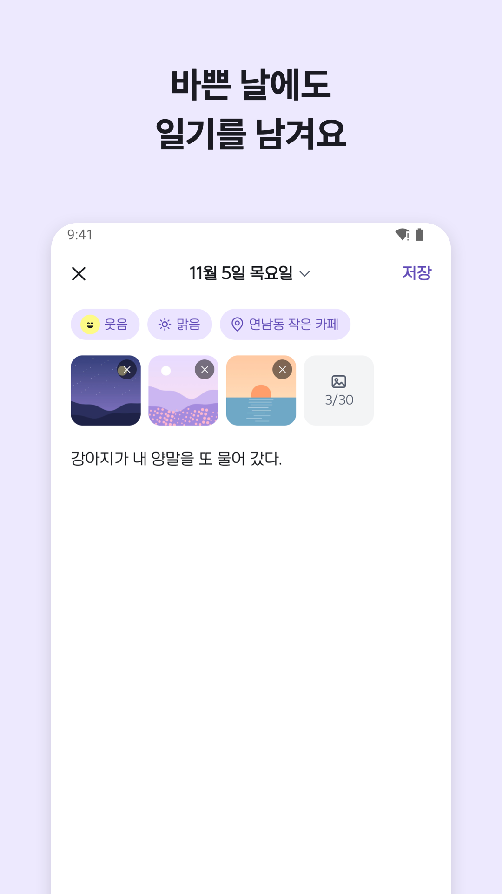
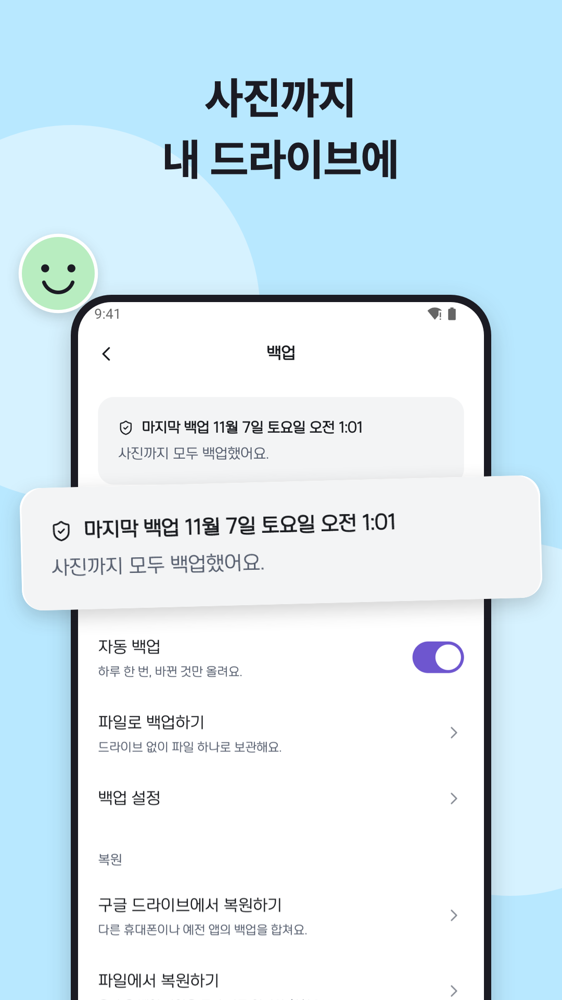
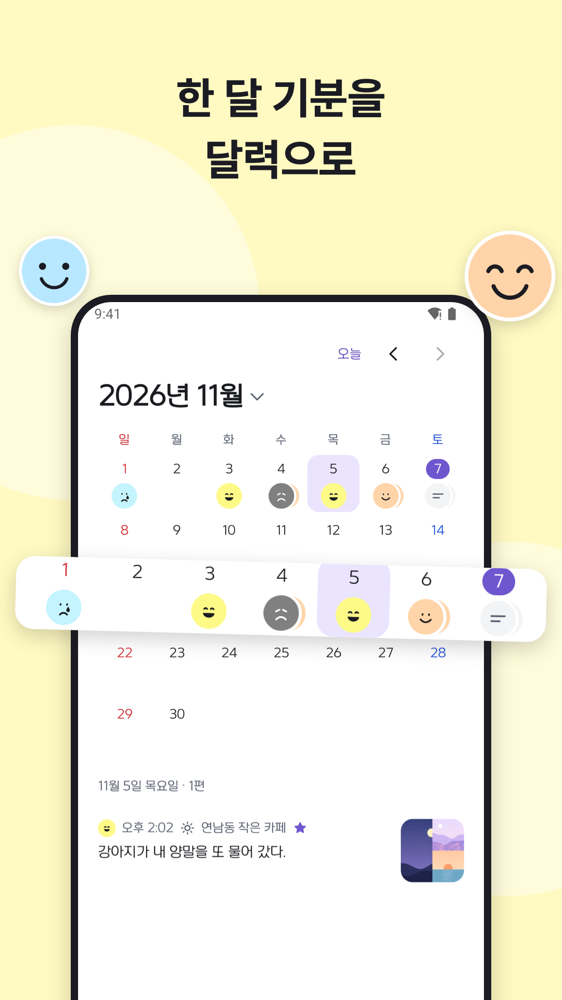
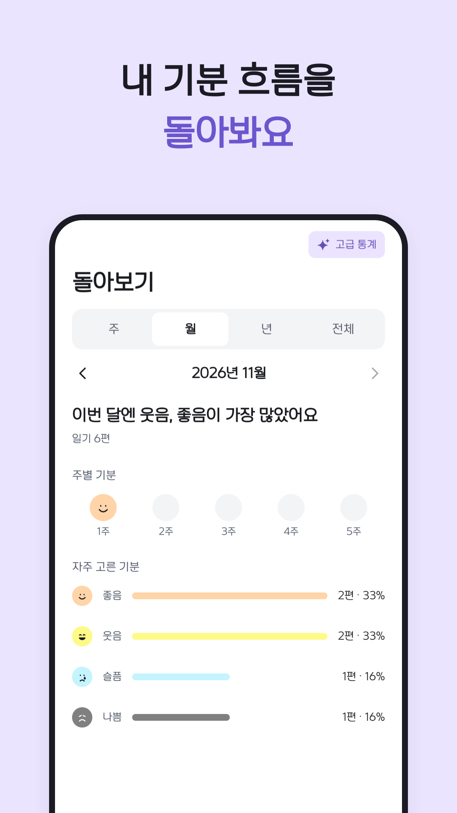
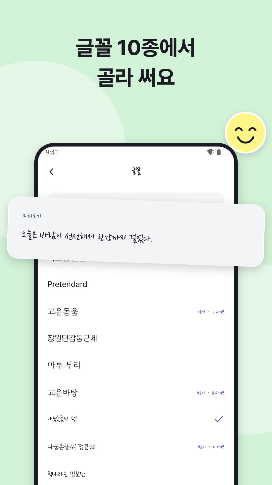

# 1일 1일기 (One Day, One Diary)

A simple diary for busy days: pick a mood, write a few lines, and the day is saved.
No sign-up. Your entries and photos are backed up only to your own Google Drive.

[Get it on Google Play](https://play.google.com/store/apps/details?id=org.sjhstudio.diary)

The version on Google Play today is 1.7.4, built with Java/Kotlin Views.
This repository is 2.0, a full rewrite in Compose Multiplatform.
2.0.0 ships as an update on Google Play, and the iOS version follows on the App Store in the next phase.
The app itself is in Korean, English, and Japanese.

<p>
  
  
  
  
  
</p>

## Features

| Feature | Details |
| --- | --- |
| Write | Text, photos, 9 moods, 7 weather types, and a place in one entry. Bold, underline, text color, highlight, and lists. Drafts survive the app being closed. |
| Look back | Find past entries by list, calendar, search, or favorites. Shared entries include the date and mood. |
| Insights | See which moods came up most by week, month, or year. |
| Backup and restore | Backs up entries and photos to your Google Drive once a day. Restoring merges with the entries already on the phone instead of erasing them. You can also move everything as a single file, without Drive. |
| Migration from 1.7.x | Moves existing entries, photos, and settings as they are. The original data is never changed or deleted. |
| Lock and trash | Lock with a PIN or biometrics. Deleted entries stay in the trash for 30 days. |
| Personalize | 10 diary fonts, body text size, dark mode, and list styles. Tablets show the list and the entry side by side. |

Everything that was free in 1.7.4, including backups with photos, stays free in 2.0.
2.0 adds ads, but never on the writing and reading screens, lock, backup, or settings.
There are two paid options.

| Product | Price | What you get |
| --- | --- | --- |
| Remove ads | ₩9,900, one-time | No ads |
| Plus | ₩14,900 per year | No ads, 30 photos per entry (10 on free), checklists, advanced insights |

## Principles

All work follows the [constitution](.specify/memory/constitution.md). In short:

1. **Never lose a record.** Migration and restore copy and verify the original before changing anything.
2. **The diary belongs to the user.** Entries, photos, and places never leave the storage the user chose. They are not included in analytics or crash reports.
3. **What was free stays free.**
4. **No paid servers.** Diaries live in the user's own Drive.
5. **Comfortable on any device.** Phones, foldables, tablets, and iPad get the same features.

## Tech stack

| Area | Used |
| --- | --- |
| Language and UI | Kotlin 2.4, Compose Multiplatform 1.12 |
| Architecture | Koin 4, Navigation 3, `build-logic` convention plugins |
| Data | Room 3 + `BundledSQLiteDriver` (FTS5, `VACUUM INTO`), DataStore, Paging |
| Editor and media | compose-rich-editor, Coil 3, FileKit, Compottie (Lottie) |
| Backup | Google Drive REST (Ktor), WorkManager, iOS BGTask, okio |
| Payments and ads | RevenueCat (Android), AdMob, Firebase Remote Config |
| Operations | Firebase Analytics, Crashlytics |
| Build and checks | AGP 9.3, Spotless (ktlint), detekt, Android Lint, Baseline Profile, GitHub Actions |

iOS payments and home screen widgets come in phase 2.
Exact versions are in [`gradle/libs.versions.toml`](gradle/libs.versions.toml).

## Project structure

```text
composeApp/       Android app (MainActivity, notification receivers)
iosApp/           Xcode project, generated from project.yml
shared/
  app/            Startup gate, navigation, dependency injection
  core/
    model/        Values shared by screens and repositories
    database/     Room database and DAOs
    datastore/    Settings and state files
    data/         Repositories (entries, trash, plans, ads, reminders)
    drive/        Google Drive REST
    backup/       Backup, restore, file export
    migration/    Migration from 1.7.x
    designsystem/ Color, type, and spacing tokens and shared components
    ui/           Screen pieces used by several features
    platform/     Android/iOS differences (expect/actual)
    testing/      Test doubles
  feature/        home, write, calendar, search, insight, trash, lock,
                  migration, settings, backup, welcome, plus
fonts/            Diary fonts downloaded on demand (Play on-demand delivery)
benchmarks/       Startup benchmarks and Baseline Profile
build-logic/      Gradle convention plugins and check tasks
app/              Legacy 1.7.4 app. Not part of the build; kept as a reference for migration
```

Dependencies flow one way: `feature → core → model`.
Screens only draw ViewModel state, and ViewModels only talk to repository interfaces.
A new feature is one `shared/feature/<name>` module plus a few lines in `AppModules.kt`.
The structure is based on [Now in Android](https://github.com/android/nowinandroid) and the [KotlinConf app](https://github.com/JetBrains/kotlinconf-app).
The comparison is in [`specs/001-foundation-migration/research.md`](specs/001-foundation-migration/research.md).

## Build and test

You need the Android SDK. Gradle downloads JDK 17 on its own.

```bash
./gradlew :composeApp:assembleDebug
```

```bash
ANDROID_SERIAL=emulator-5554 ./gradlew :composeApp:installDebug
```

The same checks as CI: formatting, design tokens, string resources, detekt, Android Lint, tests on both platforms, and the build.

```bash
./gradlew spotlessCheck designTokenCheck stringResourceCheck detekt :composeApp:lint allTests assembleDebug
```

iOS needs Xcode and xcodegen.

```bash
(cd iosApp && xcodegen generate)
```

```bash
xcodebuild -project iosApp/iosApp.xcodeproj -scheme iosApp -sdk iphonesimulator \
  -destination 'platform=iOS Simulator,name=iPhone 17' -derivedDataPath iosApp/build build
```

- UI tests (`runComposeUiTest`) live in each module's `src/iosTest` and run on the iOS simulator.
- ViewModel and repository tests live in `src/commonTest` and run on both platforms.
- `designTokenCheck` fails if screen code uses raw colors, numeric `dp`/`sp`, or string literals.
- Ad IDs, the RevenueCat key, and Firebase config files are not in the repository. The app builds without them; ads, payments, and analytics are simply off. See [`docs/release.md`](docs/release.md) to add them.

## Documents

The project documents are written in Korean.

| Document | Contents |
| --- | --- |
| [`docs/PRD.md`](docs/PRD.md) | Renewal plan overview |
| [`docs/migration.md`](docs/migration.md) | Migrating existing records. Read before changing any storage format |
| [`docs/backup.md`](docs/backup.md) | Backup, restore, and sync design |
| [`docs/design.md`](docs/design.md) | Design system and large-screen rules |
| [`docs/business.md`](docs/business.md) | Business model and free/paid scope |
| [`docs/release.md`](docs/release.md) | Store release preparation |
| [`docs/DECISIONS.md`](docs/DECISIONS.md) | Decision log |
| [`CLAUDE.md`](CLAUDE.md) | Working rules (commits, conventions, checks) |

## Workflow

- Each feature goes through planning, a Figma prototype, Figma design, a design review, development, and wrap-up. Results go in `specs/<number>-<name>/`.
- Branches: `main` (release), `develop` (development), and feature branches (`feat/<name>`). Feature branches start from `develop` and merge back into it.
- Commits follow [Conventional Commits](https://www.conventionalcommits.org/en/v1.0.0/). A Git hook enabled by the first build checks the format.
- UI strings go into the Korean, English, and Japanese string resources together.

## License

Copyright © 2021–2026 서주냥 (서준형). All rights reserved.

This repository is public so the code can be read, but it is not open source.
You may not copy, modify, or distribute this code, or publish an app built from it, without written permission. See [`LICENSE`](LICENSE).

The libraries and fonts used in the app keep their own licenses.
They are listed in the app under Settings > Open source licenses.
